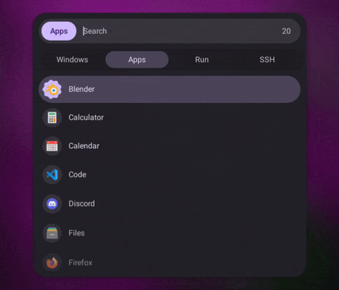
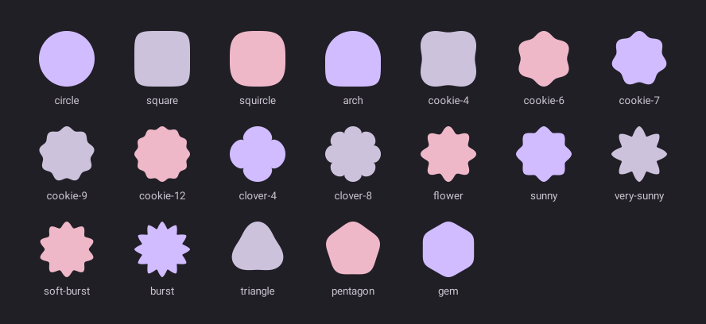
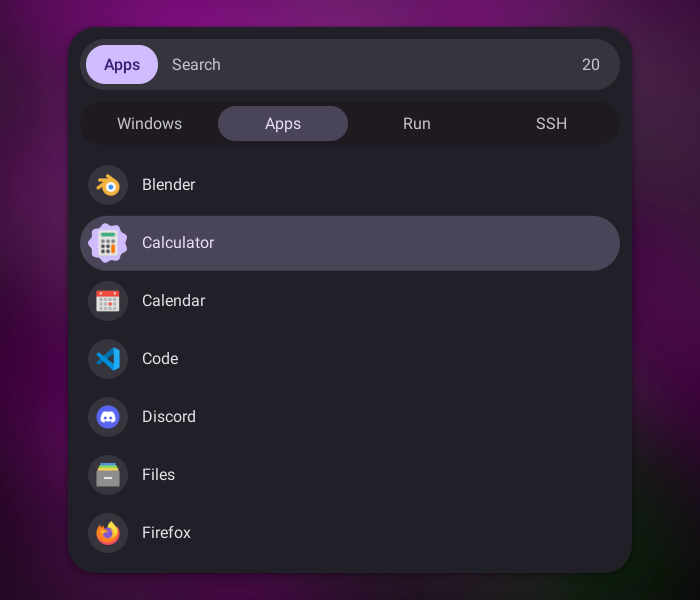
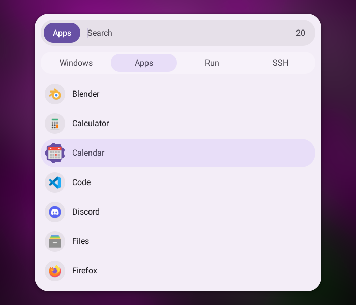
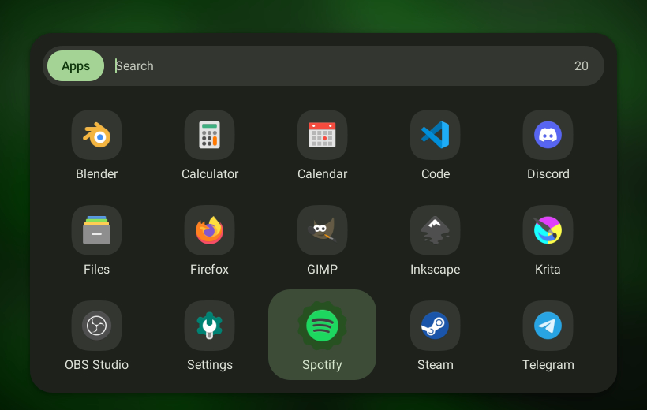

# Rofi Material You — подробная документация

Этот документ описывает **всё, что добавлено** к rofi в этом форке: движок пружинных анимаций,
новые опции, новые свойства тем, библиотеку форм, темы, генератор палитры `rofi-myou`, шаблон
matugen и Nix flake. Краткий обзор и установка — в [README](../README.md).

Содержание:

1. [Идея](#1-идея)
2. [Движение: пружины Material 3 Expressive](#2-движение-пружины-material-3-expressive)
3. [Новые опции rofi](#3-новые-опции-rofi)
4. [Новые свойства тем](#4-новые-свойства-тем)
   * [window — появление окна](#41-window--появление-окна)
   * [listview / box — индикатор выделения](#42-listview--box--индикатор-выделения)
   * [listview — каскадное появление и ripple](#43-listview--каскадное-появление-и-ripple)
   * [element-icon — формы M3 Expressive](#44-element-icon-и-другие-icon--формы-m3-expressive)
   * [textbox / entry — курсор и цвет текста](#45-textbox--entry--курсор-и-цвет-текста)
   * [scrollbar — ползунок на пружине](#46-scrollbar--ползунок-на-пружине)
   * [любой виджет — elevation (тени)](#47-любой-виджет--elevation-тени)
5. [Библиотека форм](#5-библиотека-форм)
6. [Темы Material You](#6-темы-material-you)
7. [Цветовые роли и палитра](#7-цветовые-роли-и-палитра)
8. [rofi-myou](#8-rofi-myou)
9. [matugen](#9-matugen)
10. [Nix flake](#10-nix-flake)
11. [Как это устроено (для разработчиков)](#11-как-это-устроено-для-разработчиков)
12. [Изменения в коде rofi](#12-изменения-в-коде-rofi)
13. [Совместимость и ограничения](#13-совместимость-и-ограничения)
14. [Рецепты](#14-рецепты)

---

## 1. Идея

[M3E](https://matraic.github.io/m3e/#/getting-started/overview.html) — набор веб-компонентов Material 3
Expressive: «пружинистое» движение, формы-«печеньки», тональные поверхности, индикаторы, которые
перетекают между элементами. Темы rofi (`.rasi`) умеют только статичные цвета и размеры, поэтому
перенести это «одним CSS» нельзя. Здесь эффекты встроены прямо в отрисовку rofi:

* в rofi появился **движок анимаций** с физикой пружин и токенами движения Material 3;
* виджеты rofi (список, контейнер, иконка, поле ввода, скроллбар, окно) получили **новые свойства**,
  которые включают анимации и формы;
* добавлены **темы** на этих свойствах и **генератор палитры** из обоев.

Принцип: всё новое включается **только свойствами темы**. Стандартные темы rofi и ваши собственные
темы выглядят и ведут себя как раньше.



## 2. Движение: пружины Material 3 Expressive

В Material 3 Expressive движение задаётся не длительностью и кривой, а **пружиной**: жёсткостью
(stiffness) и коэффициентом затухания (damping ratio). Пружина с затуханием меньше 1 перелетает цель
и возвращается — это и есть «пружинистость»; с затуханием 1 приходит к цели без перелёта.

Каждое анимированное значение в этом форке (позиция края индикатора, радиус, прозрачность, поворот
формы, морфинг, x курсора, …) — отдельная пружина массой 1. Шаг считается **точным решением**
уравнения затухающего осциллятора, а не численным интегрированием, поэтому результат не зависит от
частоты кадров и стабилен при любом шаге. Если цель меняется посреди движения, пружина сохраняет
скорость и плавно поворачивает к новой цели — анимации не «дёргаются» при быстрых нажатиях.

### Токены движения

| Токен | Назначение | expressive (k / ζ) | standard (k / ζ) |
|---|---|---|---|
| `spatial-fast` | быстрые перемещения, мелкие объекты | 800 / 0.6 | 1400 / 0.9 |
| `spatial-default` | перемещения и изменение размеров | 380 / 0.8 | 700 / 0.9 |
| `spatial-slow` | крупные перемещения | 200 / 0.8 | 300 / 0.9 |
| `effects-fast` | быстрые эффекты (цвет, прозрачность) | 3800 / 1.0 | 3800 / 1.0 |
| `effects-default` | эффекты | 1600 / 1.0 | 1600 / 1.0 |
| `effects-slow` | медленные эффекты | 800 / 1.0 | 800 / 1.0 |

*Spatial*-пружины двигают (позиция, размер, форма) и в схеме `expressive` заметно отскакивают.
*Effects*-пружины меняют внешний вид (прозрачность, цвет) и никогда не перелетают.

Везде, где свойство принимает пружину (`…-spring`), можно указать имя токена или свою пружину
строкой из двух чисел `"<stiffness> <damping>"`:

```css
listview { selection-indicator-spring: "spatial-slow"; }
element-icon { shape-spring: "500 0.45"; }   /* очень «желейная» */
```

### Кадры

Новый кадр запрашивается, только пока хотя бы одна пружина не успокоилась. Частота задаётся опцией
`animation-fps` (по умолчанию 120). В простое rofi не перерисовывается.

## 3. Новые опции rofi

Задаются в командной строке, в `config.rasi` (`configuration { … }`) или в самой теме.

| Опция | Тип | По умолчанию | Описание |
|---|---|---|---|
| `animations` | bool | `true` | Включает анимации. `-no-animations` выключает: все пружины сразу встают на место, темы остаются красивыми, но статичными. |
| `motion-scheme` | string | `"expressive"` | `expressive` — пружины с отскоком (M3 Expressive), `standard` — спокойные, хорошо задемпфированные (M3 standard). |
| `animation-speed` | string (число) | `"1.0"` | Множитель скорости: `2.0` — вдвое быстрее, `0.25` — замедленная съёмка. Допустимо от 0.05 до 20. |
| `animation-fps` | number | `120` | Частота кадров анимаций, от 10 до 360. |

Переменная окружения **`ROFI_NO_ANIMATION=1`** выключает анимации для одного запуска (удобно в
скриптах и на слабых машинах).

```sh
rofi -show drun -theme material-you -motion-scheme standard -animation-speed 1.5
rofi -show drun -no-animations
```

```css
configuration {
    animations:      true;
    motion-scheme:   "expressive";
    animation-speed: "1.0";
    animation-fps:   144;
}
```

## 4. Новые свойства тем

Обозначения типов как в `rofi-theme(5)`: *bool*, *number* (целое или дробное), *string*,
*distance* (`12px`, `1em`, …), *color*.

### 4.1. window — появление окна

| Свойство | Тип | По умолчанию | Описание |
|---|---|---|---|
| `open-animation` | string | `"none"` | `scale` — окно вырастает из центра; `expand` — раскрывается вниз от верхнего края, как меню M3; `slide-down` (или `slide`) — съезжает сверху; `slide-up` — поднимается снизу; `fade` — только проявление; `none` — без анимации. Все варианты, кроме `none`, одновременно проявляют окно (`effects-slow`). |
| `open-animation-spring` | string | `"spatial-default"` | Пружина движения. В темах Material You — `spatial-fast` (заметный отскок). |
| `open-animation-scale` | number | `0.92` | Начальный масштаб для `scale` (для `expand` — начальная высота `scale × 0.6`). |
| `open-animation-distance` | distance | `32px` | Путь для `slide-down` / `slide-up`. |

Анимация отсчитывается от **первого кадра, который реально попал на экран** (первый кадр rofi рисует
ещё до показа окна), поэтому её не «съедает» время запуска.

```css
window {
    open-animation:        "scale";
    open-animation-spring: "spatial-fast";
    open-animation-scale:  0.9;
}
```

### 4.2. listview / box — индикатор выделения

| Свойство | Тип | По умолчанию | Описание |
|---|---|---|---|
| `selection-indicator` | bool | `false` | Включает индикатор. |
| `selection-indicator-stretch` | bool | `true` | Передний (по направлению движения) край летит на `spatial-fast`, задний — на основной пружине: индикатор вытягивается в пути и сжимается на месте. `false` — двигается целиком. |
| `selection-indicator-spring` | string | `"spatial-default"` | Пружина (заднего края). |

Как работает: контейнер сам рисует одну скруглённую фигуру под выбранным элементом, а у
выбранного элемента **отключает собственный фон**. Цвет и радиус индикатор берёт из темы
выбранного элемента — то есть из того же `element selected.normal { background-color; border-radius; }`,
что и раньше. Поэтому включить индикатор в существующей теме можно одной строкой:

```css
listview { selection-indicator: true; }
```

Дополнительно анимируются:

* **радиус** — если у выбранного элемента другой `border-radius`, чем у обычного, индикатор
  морфится (например, 16px → пилюля);
* **цвет** — `selected.normal` → `selected.active` → `selected.urgent` перетекают плавно;
* **прозрачность** — индикатор проявляется при первом выделении и гаснет, когда список пуст.

Для `box` выбранным считается первый дочерний виджет, состояние которого начинается с `selected`.
Так работает `mode-switcher`: кнопка текущего режима получает `button selected { … }`, а индикатор
переезжает между вкладками при `Ctrl+Tab`.

```css
mode-switcher { selection-indicator: true; }
button selected { background-color: @secondary-container; border-radius: 999px; }
```

Индикатор работает в вертикальном списке, в сетке (`columns > 1`, `flow`) и в горизонтальном
`layout: horizontal`.

### 4.3. listview — каскадное появление и ripple

| Свойство | Тип | По умолчанию | Описание |
|---|---|---|---|
| `entrance-animation` | bool | `false` | При открытии строки появляются по очереди: сдвиг (`spatial-default`) + проявление (`effects-default`). |
| `entrance-stagger` | number (мс) | `30` | Задержка между соседними строками. |
| `entrance-distance` | distance | `16px` | Сдвиг строки (вертикально; для `layout: horizontal` — горизонтально; при `reverse: true` — с другой стороны). |
| `ripple` | bool | `false` | Волна от точки клика мышью по элементу: круг растёт (`effects-slow`) и гаснет (`effects-default`), обрезан по форме элемента. |
| `ripple-color` | color | цвет `element-text` с прозрачностью 12 % | Цвет волны (прозрачность берётся из цвета). |

Каскад проигрывается один раз — при открытии. Фильтрация при вводе текста его не перезапускает.

### 4.4. element-icon (и другие icon) — формы M3 Expressive

| Свойство | Тип | По умолчанию | Описание |
|---|---|---|---|
| `shape` | string | нет | Форма из [библиотеки](#5-библиотека-форм). Рисуется в квадрате содержимого иконки (без padding). |
| `shape-color` | color | нет (форма не заливается) | Заливка формы — тональная подложка под иконкой. |
| `shape-clip` | bool | `false` | Обрезать саму картинку по форме (как «формы значков» в Android 16). |
| `shape-rotation` | number (градусы) | `0` | Поворот формы. |
| `shape-spring` | string | `"spatial-fast"` | Пружина морфинга, поворота и `icon-scale`. |
| `icon-scale` | number | `1.0` | Размер картинки относительно места иконки. С подложкой удобно `0.62–0.74`. |

Все эти свойства можно задавать **по состояниям**. При смене состояния (элемент стал выбранным)
форма **морфится** в новую, поворот и масштаб идут на пружине, цвет подложки перетекает:

```css
element-icon {
    shape:        "circle";
    shape-color:  @surface-container-highest;
    icon-scale:   0.66;
}
element-icon selected {
    shape:          "cookie-9";
    shape-color:    @primary;
    shape-rotation: 30;
    icon-scale:     0.74;
}
```

Морфинг возможен между любыми формами: все они хранятся как полярный контур с одинаковой
дискретизацией (256 точек), поэтому переход — это интерполяция контуров (с отскоком пружины форма
на мгновение «перелетает» в сторону новой). Если у состояния формы нет, иконка морфится в круг и
подложка гаснет. У строк без картинки (`run`, `ssh`, …) подложка не рисуется.

### 4.5. textbox / entry — курсор и цвет текста

| Свойство | Тип | По умолчанию | Описание |
|---|---|---|---|
| `cursor-animation` | bool | `false` | Курсор скользит к новой позиции (`spatial-fast`), мигание — плавным затуханием (`effects-slow`), курсор скруглён, как в полях ввода M3. |
| `color-animation` | bool | `false` | Цвет текста плавно перетекает между состояниями (`effects-default`), например у `element-text` при выделении или у кнопок `mode-switcher`. |

### 4.6. scrollbar — ползунок на пружине

| Свойство | Тип | По умолчанию | Описание |
|---|---|---|---|
| `handle-animation` | bool | `false` | Позиция и длина ползунка движутся на пружине. |
| `handle-spring` | string | `"spatial-default"` | Пружина ползунка. |

Заодно исправлено: со `handle-rounded-corners: true` ползунок не учитывал верхний `padding`.

### 4.7. Любой виджет — elevation (тени)

| Свойство | Тип | По умолчанию | Описание |
|---|---|---|---|
| `elevation` | number 0–5 | `0` | Уровень высоты Material 3. Тень рисуется по токенам M3 (две тени — «ключевая» и «окружающая»), с гауссовым размытием, кешируется. |
| `shadow-color` | color | `#000000` | Цвет тени (прозрачность уровней берётся из токенов). |

Токены (смещение по y / размытие / разлёт / непрозрачность):

| Уровень | Тень 1 | Тень 2 |
|---|---|---|
| 1 | 1 / 2 / 0 / 30 % | 1 / 3 / 1 / 15 % |
| 2 | 1 / 2 / 0 / 30 % | 2 / 6 / 2 / 15 % |
| 3 | 1 / 3 / 0 / 30 % | 4 / 8 / 3 / 15 % |
| 4 | 2 / 3 / 0 / 30 % | 6 / 10 / 4 / 15 % |
| 5 | 4 / 4 / 0 / 30 % | 8 / 12 / 6 / 15 % |

Тень выходит за границы виджета, поэтому вокруг нужно место: в темах Material You у `window`
прозрачный `padding: 18px`, а карточка с тенью — `mainbox`. Для прозрачности в X11 нужен композитор.

## 5. Библиотека форм



| Имя | Описание |
|---|---|
| `circle` | круг |
| `square` | квадрат со скруглением (суперэллипс, n = 5) |
| `squircle` | «сквиркл» (суперэллипс, n = 3.2) — форма значков Android |
| `arch` | арка: полукруг сверху, скруглённый квадрат снизу |
| `cookie-4`, `cookie-6`, `cookie-7`, `cookie-9`, `cookie-12` | «печенье» с 4–12 зубцами |
| `clover-4`, `clover-8` | клевер с 4 и 8 лепестками |
| `flower` | цветок, 8 лепестков |
| `sunny`, `very-sunny` | «солнце», 8 мягких лучей (у `very-sunny` глубже) |
| `soft-burst`, `burst` | «вспышка» с 10 мягкими и 12 острыми лучами |
| `triangle`, `pentagon`, `gem` | скруглённые треугольник, пятиугольник, шестиугольник |

Все формы вписаны в квадрат и касаются его сторон, так что разные формы одного размера визуально
совпадают по габаритам.

## 6. Темы Material You

| Тема | Описание |
|---|---|
| `material-you` | Лаунчер: поиск в стиле M3 search bar (пилюля с чипом-подсказкой), вкладки режимов с индикатором, список с пилюлей-индикатором, иконки на круглой подложке, которые при выделении становятся `cookie-9` цвета `@primary` и поворачиваются. Тёмная схема. |
| `material-you-light` | То же в светлой схеме. |
| `material-you-grid` | Сетка 5 × 3, как в лаунчере Android: иконки 64px на `squircle`, при выделении — `cookie-12`, окно выезжает снизу (`slide-up`). |
| `material-you-grid-light` | Сетка в светлой схеме. |

| `material-you` | `material-you-light` | `material-you-grid` (палитра из зелёных обоев) |
|---|---|---|
|  |  |  |

Файлы:

```
themes/
├── material-you.rasi              @import dark + base, ?import палитры пользователя
├── material-you-light.rasi
├── material-you-grid.rasi
├── material-you-grid-light.rasi
└── material-you/
    ├── material-you-base.rasinc   все компоненты (шрифт, формы, отступы, анимации)
    ├── material-you-grid.rasinc   раскладка сетки поверх base
    ├── material-you-dark.rasinc   базовая палитра M3 (сид #6750A4), тёмная
    └── material-you-light.rasinc  то же, светлая
```

Каждая тема в конце делает `?import "~/.config/rofi/material-you/colors.rasi"`. `?import` —
необязательный импорт: если файла нет, используется встроенная палитра (в этом форке отсутствующий
необязательный импорт больше не пишет предупреждение в консоль).

В теме используются переменные формы M3: `@shape-extra-large` (28px), `@shape-large` (16px),
`@shape-medium` (12px), `@shape-full` (пилюля), и шрифты `@font`, `@font-title`.
Переопределяйте что угодно в своей теме:

```css
@theme "material-you"

* { font: "Google Sans 12"; font-title: "Google Sans Medium 12"; }
window { width: 720px; open-animation: "expand"; }
element-icon selected { shape: "clover-4"; shape-rotation: 45; }
listview { lines: 9; scrollbar: true; }
```

## 7. Цветовые роли и палитра

Цвета — переменные с именами ролей Material 3 (через дефис):

| Группа | Роли |
|---|---|
| Акценты | `primary`, `on-primary`, `primary-container`, `on-primary-container`, `secondary`, `on-secondary`, `secondary-container`, `on-secondary-container`, `tertiary`, `on-tertiary`, `tertiary-container`, `on-tertiary-container` |
| Ошибка | `error`, `on-error`, `error-container`, `on-error-container` |
| Поверхности | `surface`, `on-surface`, `surface-variant`, `on-surface-variant`, `surface-dim`, `surface-bright`, `surface-container-lowest`, `surface-container-low`, `surface-container`, `surface-container-high`, `surface-container-highest` |
| Прочее | `outline`, `outline-variant`, `inverse-surface`, `inverse-on-surface`, `inverse-primary`, `shadow`, `scrim` |

Как роли используются в темах:

| Элемент | Роль |
|---|---|
| карточка окна | `surface-container` |
| поиск | `surface-container-highest`, текст `on-surface`, подсказка `on-surface-variant`, курсор `primary` |
| чип режима (prompt) | `primary` / `on-primary` |
| вкладки | фон `surface-container-low`, выбранная `secondary-container` / `on-secondary-container` |
| выбранная строка | `secondary-container` / `on-secondary-container`; активная — `tertiary-container`; срочная — `error-container` |
| подложка иконки | `surface-container-highest`, у выбранной — `primary` (в сетке `primary-container`) |
| сообщение (`-mesg`) | `tertiary-container` / `on-tertiary-container` |
| ошибка | `error-container` / `on-error-container` |

## 8. rofi-myou

Утилита на Python (только стандартная библиотека). Генерирует роли M3 и записывает их как
переменные rofi.

```sh
rofi-myou apply ~/Pictures/forest.jpg          # из обоев
rofi-myou apply '#3F6FD8'                       # из сид-цвета
rofi-myou apply colors.json                     # из JSON matugen (`matugen … --json hex`)
rofi-myou apply ~/.local/state/material-you-terminal/theme/palette.json   # из Material-You-Terminal
rofi-myou apply wall.png -m light -t scheme-expressive -c 0.3
rofi-myou apply wall.png --set primary=#D0BCFF --set surface-container=#1D1B20
rofi-myou palette                               # показать палитру (с образцами цветов)
rofi-myou path                                  # куда пишется файл
rofi-myou reset                                 # удалить, вернуться к встроенной палитре
```

| Параметр | Описание |
|---|---|
| `-m, --mode` | `dark` (по умолчанию) или `light` |
| `-t, --scheme` | схема matugen: `scheme-tonal-spot` (по умолчанию), `scheme-expressive`, `scheme-vibrant`, `scheme-fidelity`, `scheme-content`, `scheme-rainbow`, `scheme-fruit-salad`, `scheme-neutral`, `scheme-monochrome` |
| `-c, --contrast` | контраст от -1 до 1 |
| `-s, --set ROLE=#RRGGBB` | переопределить роль (можно несколько раз; имя через `-` или `_`) |
| `--out PATH` | другой файл вместо `$XDG_CONFIG_HOME/rofi/material-you/colors.rasi` |
| `-q, --quiet` | без вывода |

Для обоев и сид-цвета нужен [matugen](https://github.com/InioX/matugen) в `PATH` (или путь в
`ROFI_MYOU_MATUGEN`); JSON-палитры читаются без него. Поддерживаются старый и новый (matugen ≥ 4)
формат JSON. Файл пишется атомарно, следующий запуск rofi уже в новых цветах.

Пример для скрипта смены обоев (swww, hyprpaper, waypaper, …):

```sh
swww img "$WALLPAPER" && rofi-myou apply "$WALLPAPER" -q
```

> Темы импортируют `~/.config/rofi/material-you/colors.rasi`. Если у вас нестандартный
> `XDG_CONFIG_HOME`, запускайте `rofi-myou --out ~/.config/rofi/material-you/colors.rasi apply …`
> или импортируйте файл в своей теме.

## 9. matugen

Если цвета рабочего стола уже генерирует matugen, rofi можно сделать ещё одним его шаблоном —
тогда `rofi-myou` не нужен. Шаблон: `templates/matugen-rofi.rasi` (устанавливается в
`share/rofi/material-you/matugen-rofi.rasi`, модуль home-manager кладёт его в
`~/.local/share/rofi/material-you/matugen-rofi.rasi`).

```toml
# ~/.config/matugen/config.toml
[templates.rofi]
input_path = '~/.local/share/rofi/material-you/matugen-rofi.rasi'
output_path = '~/.config/rofi/material-you/colors.rasi'
```

Шаблон и `rofi-myou` дают одинаковые цвета (проверено на matugen 4.2; шаблон пишет hex строчными буквами, `rofi-myou` — заглавными).

## 10. Nix flake

### Выходы

| Выход | Что это |
|---|---|
| `packages.<system>.default` / `rofi-material-you` | rofi с изменениями, обёрнутый стандартной обёрткой `rofi` из nixpkgs (иконки, SVG, плагины) |
| `packages.<system>.unwrapped` | сама сборка (как `rofi-unwrapped`); для плагинов: `pkgs.rofi.override { rofi-unwrapped = …unwrapped; plugins = [ pkgs.rofi-calc ]; }` |
| `packages.<system>.palette-preview` | палитра по умолчанию (для проверки) |
| `overlays.default` | добавляет `pkgs.rofi-material-you` и `pkgs.rofi-material-you-unwrapped` |
| `homeManagerModules.default` | модуль home-manager `programs.rofi-material-you` |
| `nixosModules.default` | модуль NixOS `programs.rofi-material-you` (+ подключает HM-модуль всем пользователям) |
| `lib.mkPalette pkgs { … }` | палитра при сборке: `source = { color | image | json }`, `mode`, `scheme`, `contrast`, `overrides`, `colors` (готовая палитра) |
| `lib.mkTheme pkgs { … }` | файл темы: `package`, `layout`, `mode`, `palette`, `font`, `width`, `animations`, `extraConfig`, `extraTheme` |
| `checks` | см. ниже |
| `devShells.default` | всё для сборки + matugen, xvfb-run, xdotool, imagemagick |

### Опции home-manager (`programs.rofi-material-you`)

| Опция | Тип | По умолчанию | Описание |
|---|---|---|---|
| `enable` | bool | `false` | Включить. |
| `package` | package | пакет из flake | Пакет rofi. |
| `layout` | `"list"` \| `"grid"` | `"list"` | Раскладка. |
| `source.color` | string | `"#6750A4"` | Сид-цвет. |
| `source.image` | path или null | `null` | Обои (приоритетнее `color`), анализируются при сборке. |
| `source.fromMaterialYouTerminal` | bool | `false` | Взять палитру `programs.material-you-terminal.colors`. |
| `mode` | `"dark"` \| `"light"` | `"dark"` | Схема. |
| `scheme` | enum | `"scheme-tonal-spot"` | Схема matugen. |
| `contrast` | float | `0.0` | От -1 до 1. |
| `palette` | attrs of str | `{}` | Переопределение ролей (`primary`, `on_surface`, …). |
| `font` | str или null | `null` | Шрифт Pango (ставит и `font`, и `font-title`). |
| `width` | str или null | `null` | Ширина окна (`"640px"`, `"40%"`). |
| `animations.enable` | bool | `true` | Опция `animations`. |
| `animations.motionScheme` | `"expressive"` \| `"standard"` | `"expressive"` | Опция `motion-scheme`. |
| `animations.speed` | float | `1.0` | Опция `animation-speed`. |
| `animations.fps` | int 10–360 | `120` | Опция `animation-fps`. |
| `extraConfig` | attrs | `{}` | Дополнительные опции в `configuration { }`. |
| `extraTheme` | lines | `""` | Rasi, дописываемый в конец темы. |
| `theme` | package (только чтение) | | Сгенерированный файл темы. |
| `dynamic.enable` | bool | `false` | Палитра на лету (`rofi-myou`), а не при сборке. |
| `dynamic.wallpaper` | str или null | `null` | Файл/симлинк обоев: systemd user path-юнит запускает `rofi-myou apply` при каждом изменении. |

Поведение:

* если включён `programs.rofi`, модуль ставит ему `package` и `theme` (`mkDefault`), иначе сам
  устанавливает пакет и пишет `~/.config/rofi/config.rasi` с `@theme`;
* при `dynamic.enable` и включённом динамическом режиме Material-You-Terminal в его хуки
  добавляется `rofi-myou apply "$MYT_PALETTE" …`;
* шаблон matugen кладётся в `~/.local/share/rofi/material-you/matugen-rofi.rasi`.

### Опции NixOS (`programs.rofi-material-you`)

| Опция | По умолчанию | Описание |
|---|---|---|
| `enable` | `false` | Пакет в `environment.systemPackages`, шрифты в `fonts.packages`. |
| `package` | пакет из flake | |
| `fonts` | `[ pkgs.roboto-flex pkgs.roboto ]` | Шрифты тем. |

Если home-manager подключён как модуль NixOS, HM-модуль автоматически добавляется в
`home-manager.sharedModules`.

### Проверки (`nix flake check`)

* сборка пакета: юнит-тесты rofi и новые тесты пружин и форм (`meson test`), затем каждая тема
  парсится самим rofi (`-dump-theme`);
* палитры через matugen в песочнице: тёмная по умолчанию, светлая `scheme-expressive` для сетки,
  с переопределениями ролей, шрифтом и `extraConfig`; каждая тема проверяется rofi без единого
  предупреждения;
* модуль home-manager вычисляется с `programs.rofi` и без;
* модуль NixOS вычисляется в минимальной системе.

То же запускает workflow `.github/workflows/nix.yml`.

## 11. Как это устроено (для разработчиков)

```
source/rofi-animation.c   пружины, токены, расписание кадров, переходы цвета
include/rofi-animation.h
source/rofi-shapes.c      библиотека форм (полярные контуры, морфинг, путь cairo)
include/rofi-shapes.h
source/widgets/indicator.c   индикатор выделения (используют listview и box)
include/widgets/indicator.h
test/animation-test.c     тесты пружин, токенов, переходов и форм
script/rofi-myou          генератор палитры
templates/matugen-rofi.rasi
themes/material-you*      темы
nix/, modules/, flake.nix Nix
```

**Пружина** (`RofiSpring`): значение, скорость, цель, константы, порог покоя. `rofi_spring_update()`
вызывается из кода отрисовки: продвигает пружину к времени текущего кадра и, если она ещё движется,
запрашивает следующий кадр. Шаг — точное решение `x'' + 2ζω x' + ω² x = 0` (три случая: ζ < 1,
ζ = 1, ζ > 1), шаг за кадр ограничен 50 мс, чтобы после подвисания ничего не «прыгало».
Для анимаций без состояния (появление окна, каскад, ripple) используется аналитический отклик
пружины на скачок `rofi_spring_step_response()`.

**Кадры**: `rofi_view_draw_main_window()` (общая для X11 и Wayland) отмечает начало кадра, ставит
хук перерисовки и рисует окно; `rofi_animation_request_frame()` ставит один таймер на
`1000 / animation-fps` мс, который помечает окно к перерисовке. Пока все пружины в покое, таймеры
не ставятся.

**Индикатор**: контейнер перед отрисовкой детей находит выбранного, берёт прямоугольник его фона,
цвет и радиус из темы, выключает ему фон (`widget_set_background_suppressed`) и рисует себя. Четыре
края — четыре пружины; при смене цели по каждой оси передний край получает `spatial-fast`.

**Полупрозрачная отрисовка**: при анимации появления окно и строки рисуются в промежуточный
image-буфер и выводятся с прозрачностью (`widget_draw_with_alpha`). Группы cairo
(`cairo_push_group`) для этого не используются: на поверхностях xcb они теряют прозрачность теней.

**Тени**: обе тени уровня рисуются в маску A8, размываются тремя проходами box blur
(≈ гауссово размытие с σ = blur / 2) и кешируются в виджете по размеру, радиусу и уровню.

## 12. Изменения в коде rofi

| Файл | Изменение |
|---|---|
| `source/view.c`, `include/view-internal.h` | `rofi_view_draw_main_window()`: анимация появления, хук кадров, отсчёт от первого видимого кадра |
| `source/xcb/view.c`, `source/wayland/view.c` | рисуют окно через `rofi_view_draw_main_window()` |
| `source/widgets/widget.c`, `widget.h`, `widget-internal.h` | `elevation` / `shadow-color`, отключение фона для индикатора, `widget_get_background_rect()`, `widget_draw_with_alpha()`, `rofi_rounded_rectangle()` |
| `source/widgets/listview.c` | индикатор, каскад, ripple; отрисовка разделена на «разложить элементы» и «нарисовать» |
| `source/widgets/box.c` | индикатор для выбранного ребёнка |
| `source/widgets/icon.c` | формы, морфинг, поворот, `icon-scale` |
| `source/widgets/textbox.c`, `textbox.h` | `cursor-animation`, `color-animation` |
| `source/widgets/scrollbar.c`, `scrollbar.h` | `handle-animation`; исправлен отступ скруглённого ползунка |
| `source/theme.c`, `include/theme.h` | `rofi_theme_get_color_value()` — чтение цвета без отрисовки |
| `include/settings.h`, `config/config.c`, `source/xrmoptions.c` | опции `animations`, `motion-scheme`, `animation-speed`, `animation-fps` |
| `lexer/theme-lexer.l` | отсутствующий `?import` — отладочное сообщение вместо предупреждения |
| `meson.build` | новые исходники, тест, установка тем, `rofi-myou` и шаблона |
| `.gitignore` | правило `core` → `/core` (иначе в git не попадал `subprojects/libnkutils/core/`) |
| `.github/workflows` | удалены апстримные публикация релизов, документации и автозакрытие issue; добавлен `nix.yml` |

Подмодули `libgwater` и `libnkutils` вшиты в `subprojects/`, чтобы репозиторий собирался из
простого `git clone` и как источник flake.

## 13. Совместимость и ограничения

* **Старые темы** не меняются: все эффекты выключены по умолчанию. Единственное видимое изменение
  поведения — исправленный отступ у `handle-rounded-corners`.
* **X11**: прозрачные области (скругления окна, тени) требуют композитора. Без него задайте
  `window { transparency: "background"; }` или уберите у окна `padding` и у `mainbox` `elevation`.
* **Wayland**: анимации используют тот же код, что и в X11 (общая функция отрисовки окна), и
  собираются в бэкенде Wayland, но вручную проверены только в X11 (Xvfb); частоту кадров там
  дополнительно ограничивают колбэки кадров композитора. Если заметите проблему — выключите
  анимации (`-no-animations`) и напишите, что именно не так.
* **Производительность**: во время анимации окно перерисовывается целиком на каждом кадре; в простое
  перерисовок нет. Плавное мигание курсора даёт ~0,3 с перерисовок раз в 1,2 с — выключается
  `entry { cursor-animation: false; }`. На очень слабых машинах: `-motion-scheme standard`
  (быстрее успокаивается), `-animation-fps 60` или `-no-animations`.
* **Анимации закрытия нет**: rofi выполняет действие сразу; задерживать запуск программы ради
  эффекта было бы хуже.
* Каскад запускается один раз при открытии, а не при каждой фильтрации.

## 14. Рецепты

**Добавить индикатор в любую существующую тему:**

```css
@theme "Arc-Dark"
listview { selection-indicator: true; entrance-animation: true; }
```

**Спокойная анимация, без отскоков:**

```css
configuration { motion-scheme: "standard"; }
```

**Иконки в форме Android 16 «печенье»:**

```css
element-icon { shape: "cookie-4"; shape-clip: true; }
```

**Меню, раскрывающееся сверху (например, для панели):**

```css
window { location: north; anchor: north; open-animation: "expand"; }
```

**Медленная съёмка, чтобы рассмотреть физику:**

```sh
rofi -show drun -theme material-you -animation-speed 0.2
```

**dmenu-скрипт без анимаций:**

```sh
ROFI_NO_ANIMATION=1 rofi -dmenu -theme material-you
```
